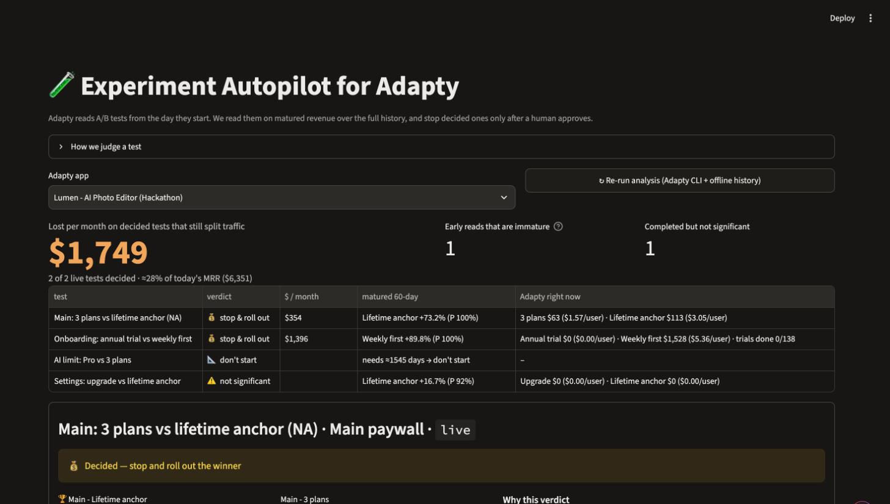
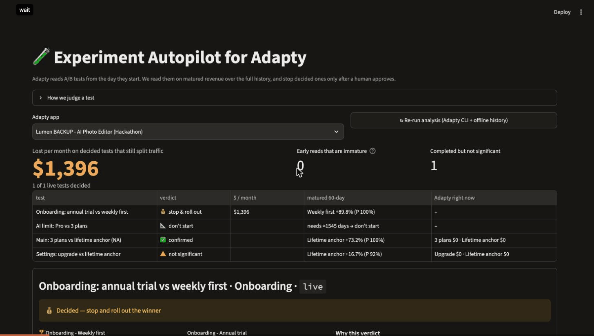

# Experiment Autopilot for Adapty

**Adapty Hackathon Belgrade, 7–8 Nov 2026 · Team 11**



### Result in 30 seconds

- Lumen keeps **two decided A/B tests** at 50/50. Judged on matured 60-day revenue, they cost **≈$1,749/month**,
  about 28% of today's MRR ($6,351, read from Adapty).
- Adapty's own numbers are early. In the onboarding test, **0 of 138 trials have finished**, so the annual-trial arm
  shows $0.
- A completed test was **not significant** on the full history, and a draft would need **≈1,545 days** at this
  traffic.
- One approved click stops a decided test in Adapty: the plan is re-checked on fresh data and written to an audit log.
- Read-only online version for the jury: https://claude.ai/artifact/6cBq6iQkhck8NfCxKoBQhk



Adapty's A/B page judges a test from the day it starts. Early on, part of the revenue hasn't happened yet: an
annual plan with a 7-day trial pays nothing in week one, a weekly plan pays on day one. Experiment Autopilot judges
every Adapty test on **matured 60-day revenue over the full history**. It runs the health checks of experimentation
platforms (traffic split, randomization balance, guardrails, revenue maturity, segment consistency), puts a **dollar
figure on keeping a decided test running**, and stops it through the Adapty CLI **only after a human approves**. A
Claude Code skill gives the same functions to an AI agent, with the same approval gate.

## Result on the Lumen demo app

| Test | Adapty dashboard after 15 h | Experiment Autopilot (60-day revenue, 4 months) | Verdict |
|---|---|---|---|
| Main paywall, US & CA (live) | P2BB 68%: keep waiting | Lifetime anchor $15.99 vs $9.23 (**+73%**, CI $4.79…$8.88); no segment reversed (8/10 clearly ahead, 2 too small to tell) | stop & roll out, **$354/mo** |
| Onboarding (live) | P2BB 100% for Weekly, but Annual trial shows $0 because its 7-day trial hasn't converted yet | Weekly $8.56 vs $4.51 (**+90%**), confirmed on matured revenue; ⏱️ immature-revenue warning | stop & roll out, **$1,396/mo** |
| Settings (completed) | completed | not significant (P 92%, CI −$0.61…$4.13) | ⚠️ result was trusted too early |
| AI limit (draft) | draft | ≈2,233 users/arm for a 10% lift ≈ 1,545 days at Lumen traffic (≈3 users/day at that placement) | 📐 don't start as designed |

**≈ $1,749/month** on the losing arms of the two live tests: one month of new installs, each followed for 60 days,
at Lumen scale. That is about a quarter of Lumen's $6.4k MRR.

## Business case

- **Buyer:** growth teams on Adapty that run paywall and onboarding experiments, from one app to a portfolio.
- **Value:** on Lumen, ≈$1,749/month on losing arms of decided tests (≈ a quarter of MRR), plus fewer rollouts of
  winners that were not significant (the Settings test).
- **Model:** a native Adapty feature next to Autopilot. Autopilot proposes the *next* test; Experiment Autopilot
  *closes* running ones safely. That makes Adapty's experimentation loop end-to-end and is a natural paid-tier
  feature. A standalone add-on on top of the Adapty CLI/MCP is also possible.
- **Next step:** read user→arm history from Adapty's S3/BigQuery export, so it works on every app, not just the
  seeded one.

## Who it is for

Growth and product people running paywall and onboarding experiments in Adapty. Today they read the A/B page, which
covers recent users only, often before trial revenue arrives. Experiment Autopilot changes **money** (no more paying
for decided losing arms) and **risk** (no rollout without health checks, guardrails, a segment check and an explicit
approval).

## How it works

1. **Adapty CLI**: `ab-tests list/get` for tests, arms, weights and audiences. `flows metrics get --based-on
   audience` gives the live view: users, revenue, trials and **finished** trials per arm since the test started,
   counting only users inside the test, because the same flow can also be shown outside it. The numbers match the
   dashboard.
2. **Full history**: the offline dataset says which arm every user saw. Net revenue in the first 60 days counts
   trials as $0 and removes refunds, and only users whose 60 days have passed are included.
3. **Decision**: revenue per user per arm, bootstrap 95% CI, P(winner better), and an always-valid p-value (mixture
   SPRT), so re-checking the same test every day in the dashboard or a cron doesn't inflate false winners. A completed
   test is `completed_confirmed` only if all comparisons and health, guardrail and segment checks pass, and the
   known applied winner matches the history winner. Verified history that favours another applied arm gives
   `completed_disagrees`; missing applied-winner metadata gives `completed_winner_unknown`. Neither confirms the
   rollout. Insufficient revenue evidence gives `completed_inconclusive`; failed safety checks on an otherwise
   decided completed test give `completed_check_failed`.
4. **Health** (as in GrowthBook): SRM on the traffic split; randomization balance on a pre-exposure intent score.
5. **Guardrails** (as in GrowthBook/Eppo): refund rate and billing-issue rate **per charge**. A per-payer rate would
   penalise weekly plans for charging more often. P-values come from a bootstrap over **users**, because renewals
   of one user are correlated.
6. **Revenue maturity**: share of 60-day revenue each arm has collected by day 1/7/30/60. If the arms differ by
   ≥ 25 points on day 1, an immature-revenue warning explains which arm an early read favours.
7. **Segments**: the same comparison inside intent (low/mid/high from a cross-fitted gradient-boosting model on
   day-one signals), platform and acquisition channel, Bonferroni-corrected.
8. **Planning**: sample size for a 10% lift, days to a decision, and the smallest lift visible in 30 days, using
   only the traffic of the draft's own placement and its smallest configured arm share. Enrolment days are
   `n / (daily users × smallest share)`, plus the revenue window; the 30-day MDE uses the same share. Missing history,
   insufficient matured users, or no usable traffic/allocation gives **can't size**, never a recommendation to start.
   Tests with 3+ arms compare the winner with **every** losing arm: bootstrap CI, always-valid p, guardrails and
   segments must pass for each comparison before rollout. An unverified revenue comparison leaves `keep_running`;
   failed health/guardrail/segment checks retain their non-actionable verdicts. Money counts only verified losing
   arms. The revenue horizon is read from the test goal ("…60-day revenue…"), with 60 days as the default.
9. **Change Guard**: shows what changes, the audience, who is affected, the expected effect, and that a stop can't be
   undone. After approval by a named person it re-judges on fresh data, runs `adapty ab-tests stop <id> --winner <id>`
   and appends to `out/audit.log`. The CLI and the dashboard share this one path.

The dashboard labels **Adapty API (live)**, **synthetic history**, and **saved report (offline)** by section, with
the UTC analysis time and last date covered by history. A report read from Adapty within the last hour (e.g. by
`pa.cli check` before the demo) shows as **Adapty API, read N min ago**; an older one shows its age as a warning; re-run
analysis to refresh it. The hero expander retains the unrounded traffic inputs, the 5k/50k scaling, per-arm revenue gaps and
two-arm 95% monthly loss intervals. These estimate the revenue of new cohorts over the test horizon, not MRR.

## Run

```bash
cp .env.example .env                 # app id + path to the seed repo's data/offline
npm i -g adapty && adapty auth login
uv sync
uv run python -m pa.cli check        # Markdown brief (writes out/report.json)
uv run python -m pa.cli portfolio    # every app the Adapty account can open
uv run python -m pa.cli notify       # Slack digest: posts if SLACK_WEBHOOK_URL is set, else saves a preview
uv run streamlit run app.py          # dashboard (app selector, Slack preview, portfolio scan)
bash .claude/verify.sh               # compile, tests and live checks; accepts completed_confirmed after a stop
```

### Seed a rehearsal app

From this repository, with the Adapty CLI logged in and the seed repo at
`../hackaton_adapty/adapty-seed-data-hack`, create a fresh copy. Use a new title and bundle IDs for later copies:

```bash
adapty apps create --title "Lumen BACKUP 3 - rehearsal" \
  --platform ios --apple-bundle-id com.example.lumen.rehearsal3 \
  --platform android --google-bundle-id com.example.lumen.rehearsal3 --json
REHEARSAL_APP_ID="<id from apps create>"
python3 ../hackaton_adapty/adapty-seed-data-hack/seed_adapty.py \
  --app-id "$REHEARSAL_APP_ID" --skip-data
export OFFLINE_APP_IDS="${OFFLINE_APP_IDS:+$OFFLINE_APP_IDS,}$REHEARSAL_APP_ID"
uv run python -m pa.cli check --app "$REHEARSAL_APP_ID"
uv run streamlit run app.py
```

Select the new app, or open `http://localhost:8501/?app=<id>`. Keep the exported variable in the shell that starts
the CLI and Streamlit; this appends the rehearsal ID to any existing comma-separated history apps. The default
Lumen app always keeps its history. `--skip-data` creates the catalog, flows, placements, segments and tests;
it does not replay users or purchases and needs no secret API key. Its matured results use the same synthetic
offline history. Leave the main Lumen tests live for the demo.

### For AI agents (Claude Code)

`.claude/skills/experiment-autopilot/SKILL.md` teaches the agent `pa.cli check → plan → stop`. `stop` needs
`--winner-id` (from the approved plan) and `--approved-by`. It re-judges on fresh data right before acting and
refuses if the verdict changed or the fresh winner differs from the approved one, then writes the audit log. The
dashboard's Stop button applies the same fresh re-check.

Tests: `uv run pytest -q` runs **66 behaviour tests**, including dashboard rendering, with the Adapty CLI mocked
from fixtures. They cover the post-stop state, fresh-winner and health refusals, applied-winner confirmation,
multi-arm outliers and safety checks, weighted draft sizing, source/freshness labels, auditable loss intervals,
other apps without history, test-only live metrics and the Slack digest.

## Limits

- Full-history judgement needs the user→arm history (here the offline dataset; in production an Adapty S3/BigQuery
  export). Without it the tool still shows the live view and the plans.
- Paywall-type tests are listed as "can't judge on history yet" with what Adapty sees; the offline dataset has flows only.
- Dollar figures are scaled to Lumen's live size (5k of 50k offline users).
- Monthly loss intervals scale the existing two-arm revenue-gap bootstrap with traffic and allocation held fixed;
  they exclude traffic uncertainty. There is no aggregate multi-arm interval. The estimate is expected revenue of
  new cohorts over the horizon, not MRR.
- A history winner cannot establish which arm was applied. If the API omits applied-winner metadata, a completed
  result stays `completed_winner_unknown`; if a verified history winner differs, it is `completed_disagrees`.
  An acknowledged Change Guard stop records the applied ID in the saved report; a later API rebuild needs that
  metadata again.
- Segments with fewer than 80 users per compared arm are skipped. Unclear segment intervals are not reversals;
  rollout does not prove a positive lift in every small segment.
- SRM uses the arm weights as configured now; Adapty keeps no weight history, so a split changed mid-test can show
  up as SRM. Arms at weight 0 are left out of the check.
- The history belongs to the earliest started test with a given title; a later copy is listed with what Adapty sees
  until it has matured users of its own.

## Data and AI disclosure

- Only the synthetic Lumen demo data from `kpotehin/adapty-seed-data-hack`. No real user data.
- All code was written during the hackathon with Claude Code (Opus 5.5) as a pair programmer. Pre-existing: open-source
  libraries only (pandas, scikit-learn, scipy, streamlit, altair). The health-check patterns follow public
  GrowthBook/Statsig/Eppo documentation; no code was copied.
